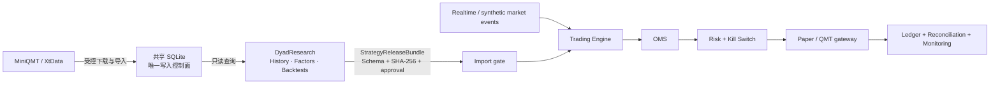

# DyadTetrade

DyadTetrade 是一个 Paper-first 的 A 股交易执行与监控平台，聚焦实时行情、策略运行、OMS、风险状态机、账户账本、券商对账和运维监控。公开版只能以 `disabled` 或 `paper` 模式启动；真实交易默认关闭，CI 断言真实报单数为零。

可信度来自 fail-closed 交易链路：订单先经过策略发布、执行股票池、幂等键、风险检查和 OMS，再到 Broker 抽象；回调乱序按单调状态合并；重启后恢复活动订单并对账；Kill Switch、额度、白名单、每日发布和确认短语都不能被公开演示绕过。仓库不包含账户、成交记录、QMT 缓存、券商 SDK 二进制或私有数据库。

## 5 分钟 Paper 演示

```powershell
py -3.12 -m venv .venv
.venv\Scripts\python -m pip install -e ".[trading,dev]"
$env:DYADTETRADE_EXECUTION_MODE = "paper"
$env:DYADTETRADE_ENABLE_LIVE_TRADING = "false"
.venv\Scripts\python -m alembic upgrade head
.venv\Scripts\python -m uvicorn dyadtetrade.api.main:app --host 127.0.0.1 --port 8000
```

访问 `http://127.0.0.1:8000/docs`。产品 API 注册系统健康、运行监控、策略目录、发布包验收、Paper、执行、实时路由，以及本机 XtData 下载/受控共享导入；研究查询、历史回测、参数优化和任意策略文件执行不进入交易运行时。`dyadtetrade.api.public_app` 另提供只能以 disabled/paper 启动的最小公开演示面。

前端：

```powershell
cd frontend
npm ci
npm run test
npm run dev
```

## XtData 本地配置

仓库中的 `config/market_data.yaml` 只保存可公开、可移植的默认值。需要访问本机 MiniQMT 时，将
`config/market_data.local.example.yaml` 复制为 `config/market_data.local.yaml`，再填写本机
`userdata_mini`、QMT `datadir` 和 `site-packages` 路径。本地覆盖文件已被 Git 忽略，并会在环境变量
覆盖之前自动合并；也可以使用 `.env.example` 中的 `DYADTETRADE_DATA__QMT__*` 变量覆盖配置。

## 与 DyadResearch 的分工



DyadResearch 负责历史只读查询、PIT 财务、因子、回测、复现和研究报告。DyadTetrade 负责 XtData 下载/共享导入控制面，以及实时与交易状态。两个项目不互相导入 Python 代码；研究端通过 loopback HTTP 请求同一个数据控制面，研究成果仍只通过 `contracts/strategy-release-bundle.schema.json` 描述的版本化发布包进入执行端。

## 主要能力

- Paper Broker：下一 Bar 撮合、部分成交、成交量参与率、A 股费用、T+1 与涨跌停约束。
- OMS：幂等委托、状态单调合并、撤单、成交归属与重启恢复。
- 风控：五态运行状态、订单/仓位/日内额度、Kill Switch、只撤单和禁止开仓模式；HALTED/RECOVERY 状态下可在前端调低启动配置给出的风险上限并持久化审计。
- 执行发布：每日执行股票池、策略版本、参数哈希、风险预算、人工激活和撤销审计。
- QMT 隔离：适配器源码可见但 SDK 与账号不随仓库分发；qmt_sim/qmt_live 由独立进程和配置门禁控制。
- 行情与数据：有界实时轮询、分钟聚合、策略心跳和连续性检查；XtData 下载覆盖历史、财务、板块、历史合约、节假日、可转债、ETF 与指数权重，原始 1d/1m 可受控导入共享 SQLite。

Paper 模拟费用默认佣金万一且最低 5 元，卖出印花税万五。通用撮合、费用和交易约束位于 `modules/simulation`；旧 `modules/backtest` 导入仅在私有迁移仓保留弃用门面，不进入干净公开导出。

## StrategyReleaseBundle

导入器校验完整文件集、JSON Schema、SHA-256、策略白名单、运行时 API、数据能力、参数与风险预算。带可执行 `strategy.py` 的包进入 qmt_sim/qmt_live 前还必须通过配置的签名验证；`paper_approved` 最多只进入 Paper，不能升级为实盘授权。任意路径、符号链接、嵌套文件和多余文件都会被拒绝。

## 工程门禁

```powershell
$env:DYADTETRADE_ENABLE_LIVE_TRADING = "false"
.venv\Scripts\python -m ruff check src tests
.venv\Scripts\python -m ruff format --check src tests
.venv\Scripts\python -m mypy -p dyadtetrade
.venv\Scripts\python -m pytest
cd frontend
npm run test
npm run lint
npm run build
```

从 DyadResearch 复制发布包到 `data/strategy_bundles/inbox/<bundle-name>` 后，可在“策略 → 执行发布”先校验留痕，再将 qmt_sim/qmt_live 包绑定当日已激活执行股票池，登记为待人工激活草稿。

交易状态、账本、精度和受控发布见 [TRADING_STATE_MACHINE.md](docs/TRADING_STATE_MACHINE.md)、[ORDER_LEDGER.md](docs/ORDER_LEDGER.md)、[PRECISION_AND_ACCOUNTING.md](docs/PRECISION_AND_ACCOUNTING.md) 与 [FULL_MARKET_AUTOMATED_EXECUTION.md](docs/FULL_MARKET_AUTOMATED_EXECUTION.md)。许可证和安全政策见 [DEPENDENCY_LICENSES.md](DEPENDENCY_LICENSES.md)、[THIRD_PARTY_NOTICES.md](THIRD_PARTY_NOTICES.md) 和 [SECURITY.md](SECURITY.md)。

## 当前限制

- 公开版不连接真实资金账户，不提供实盘证据，也不保证任何收益。
- MiniQMT/XtQuant 需要用户自行合法安装并登录；无 QMT 环境使用 Paper、Mock 或合成事件。
- 私有仓仍保留若干研究/历史模块作为迁移期对照，公开导出会阻断并剔除它们；长期删除计划属于 P1。
- 本项目不是券商交易终端替代品。任何 qmt_live 使用都需要独立人工审批、当日发布、白名单、对账与回滚预案。
