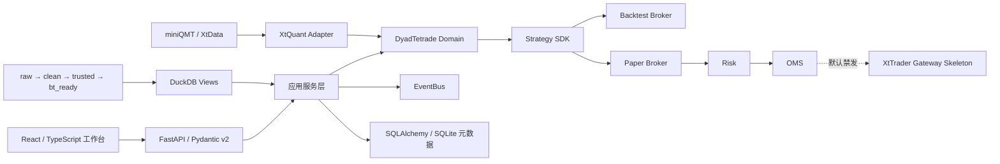

# DyadTetrade 技术手册

审计日期：2026-07-12  
适用版本：`0.1.0`（模块化单体，研究 / 回测 / Paper / qmt_sim 阶段）  
项目根目录：`<path-to-DyadTetrade>`

## 1. 项目定位与当前结论

DyadTetrade 已经不再只是一个行情下载脚手架，而是一个能够在 Windows 本地实际运行的 A 股量化研究工作台。当前已经形成以下安全闭环：

```text
miniQMT / XtData 只读行情
→ raw / clean / trusted / bt_ready Parquet
→ 股票池或时点成分
→ 策略 SDK / 因子研究
→ 自研 A 股事件驱动回测
→ 订单、成交、持仓、净值、指标持久化
→ JSON / CSV / HTML / PDF / SVG 报告
→ React 前端查看
→ 参数优化和稳健性检验
→ 同一策略进入 Paper Trading
→ OMS、风控、监控和恢复
```

系统的真实交易能力仍被有意封闭：

```text
DYADTETRADE_ENABLE_LIVE_TRADING=false
```

当前 XtTrader 边界支持模拟账户连接、订阅、异步委托、撤单、回调、重连和重启对账，并新增
真实账户发布门禁。`qmt_live` 只有在账号白名单、当天发布日期、人工确认、标的白名单和限额
全部满足时才能启动；默认启动仍为 `qmt_sim`。

## 2. 本次文件审计范围

本次检查从项目根目录递归盘点了全部内容：

| 范围 | 文件数 | 大小 | 处理方式 |
|---|---:|---:|---|
| 全文件夹 | 147,771 | 约 4.25 GB | 完整枚举和分类 |
| `.venv` | 74,121 | 约 2.72 GB | 校验环境和安装包，不逐字审阅第三方包源码 |
| `references` | 62,048 | 约 1.22 GB | 审阅项目清单、README、许可证、关键架构入口和已有技术参考 |
| `frontend` | 10,730 | 约 202 MB | 审阅自有源码和配置；依赖、构建产物仅统计 |
| `src/dyadtetrade` | 87 个 Python 文件 | 约 10,535 行 | 全量语法、类型、测试和静态检查 |
| `tests` | 22 个 Python 文件 | 约 2,217 行 | 全量执行 |
| 项目自有文本文件 | 约 169 | — | 逐类核读 |

二进制数据库、Parquet、PDF、图片、编译扩展、缓存、`node_modules` 和第三方虚拟环境没有被错误地当作项目业务源码逐字解释；它们通过文件元数据、格式读取、数据库查询或对应工具进行验证。`.env` 只核对键名，没有在手册中泄露任何值。

`references/miniqmt_projects` 中现有 13 个主要开源快照：

- `ashares_data_collect`
- `bullet-trade`
- `easytrader`
- `lite-qmt-executor`
- `miniqmt-demo`
- `OSkhQuant`
- `qmt-bridge`
- `QMT-MCP`
- `quant-qmt-proxy`
- `vnpy`
- `vnpy_qmt`
- `xqshare`
- `XtQuant`

它们仅用于设计参考，不是 DyadTetrade 的运行依赖。项目已经吸收的重点是：数据任务恢复、网关隔离、领域对象、事件分发、策略/数据/Broker 解耦和安全的 QMT 适配边界。

## 3. 完成度总览

| 模块 | 状态 | 当前能力 |
|---|---|---|
| 行情与数据中心 | 已可用 | XtData 只读、目录同步、历史任务、四层 Parquet、质量报告、DuckDB 查询 |
| 股票池与标的管理 | 已可用 | 市场/类型/行业/板块/指数/自定义池、历史快照查询 |
| 统一领域模型 | 已可用 | 行情、信号、订单、成交、持仓、账户、组合、公司行动和风控对象 |
| 事件系统 | 已可用 | 同步、异步、队列工作线程、定时、追踪、异常隔离、重放 |
| 策略 SDK | 已可用 | 统一生命周期、上下文、注册发现、状态快照和 4 个示例策略 |
| 因子研究 | 已可用 | 预处理、IC/RankIC、ICIR、分组、多空、换手、衰减、暴露和持久化 |
| A 股回测 | 已可用 | 日/分钟 Bar、下一 Bar 撮合、T+1、费用、涨跌停、部分成交和会计检查 |
| 绩效与报告 | 已可用 | 绩效指标、基准对齐、JSON/CSV/HTML/PDF/SVG |
| 参数优化 | 已可用 | 网格、随机、Optuna、多目标、并行、恢复、Pareto 和稳健性检验 |
| 投资组合 | 已可用 | 多种配置方法、CVXPY 约束、再平衡计划和订单意图 |
| Paper Trading | 已可用 | 模拟账户、撮合、T+1、费用、状态恢复、策略运行和对账 |
| OMS | 已可用 | 客户端订单 ID、幂等键、状态机、审计关联和恢复基础 |
| 风险控制 | 已可用 | 交易前/交易中规则、全局/账户/策略开关和风险事件 |
| 监控和可观测性 | 已可用 | 健康、就绪、Prometheus、请求 ID、WebSocket 状态流 |
| React 前端 | 已可用 | 10 个工作页面、类型化 API、实时策略/账户监控、图表和任务操作 |
| XtTrader 模拟网关 | 已可用 | qmt_sim 连接/订阅、查询、异步委托、撤单、回调、重连和对账 |
| XtTrader 实盘网关 | 发布门禁完成 | 默认关闭；账号白名单、每日确认和逐单确认缺一不可 |
| 算法执行优化 | 未完成 | 尚无 TWAP/VWAP/盘口队列等执行算法 |
| 配置、账户和权限 | 基础 | 环境配置已有；用户认证、RBAC 和密钥管理未完成 |

## 4. 总体架构

DyadTetrade 采用模块化单体。所有模块在一个部署单元内运行，但边界清晰，避免研究代码直接耦合券商 API。



核心边界规则：

1. 策略、回测、风控、OMS 和前端不接触 XtQuant 原始对象。
2. XtQuant 对象必须在 `integrations` 边界转换为领域对象。
3. 策略只能通过 `StrategyContext` 读取数据和产生订单意图。
4. SQLite 保存业务元数据；大规模时序数据保留在 Parquet，并由 DuckDB 查询。
5. 研究、回测、Paper 和未来实盘使用同一套领域协议，但使用不同 Broker/Gateway。

## 5. 目录说明

```text
DyadTetrade/
├─ src/dyadtetrade/
│  ├─ api/                 FastAPI 应用、路由、中间件
│  ├─ core/                配置、日志、指标、证券代码
│  ├─ db/                  SQLAlchemy、仓储、Parquet、DuckDB
│  ├─ domain/              厂商无关领域对象和枚举
│  ├─ events/              事件总线
│  ├─ integrations/        XtData 与 XtTrader 适配边界
│  └─ modules/
│     ├─ market_data/      行情流水线和下载任务
│     ├─ universe/         标的目录和股票池
│     ├─ strategy/         策略 SDK
│     ├─ research/         因子工作台
│     ├─ backtest/         自研事件驱动回测
│     ├─ performance/      指标计算
│     ├─ reporting/        多格式报告
│     ├─ optimization/     参数搜索和稳健性
│     ├─ portfolio/        组合配置和订单意图
│     ├─ oms/              订单管理
│     ├─ risk/             风险控制
│     └─ paper_trading/    模拟交易与策略运行
├─ frontend/               React + TypeScript + Vite + ECharts
├─ alembic/                10 个增量迁移
├─ data/                   四层行情、SQLite 和 DuckDB
├─ reports/                质量、因子、优化、回测和验收报告
├─ tests/                  后端自动化测试
├─ scripts/                环境、数据、检查和验收脚本
├─ deploy/                 Docker / Nginx 部署骨架
├─ references/             QMT 文档和第三方源码快照
└─ .agents/skills/         项目级 Codex Skills
```

## 6. 运行环境和技术栈

- Python：3.12.0，项目独立 `.venv`。
- 核心计算：NumPy、Pandas、SciPy、PyArrow、Polars、Numba。
- 时序存储：Parquet + DuckDB。
- 业务存储：SQLAlchemy 2 + SQLite；已安装 PostgreSQL/Redis 客户端但尚未切换。
- 服务：FastAPI、Pydantic v2、Uvicorn、WebSocket、Prometheus。
- 研究回测：自研引擎为核心；Backtrader、VectorBT 作为核对和研究辅助。
- 优化：Optuna、CVXPY、Nevergrad。
- 报告：Matplotlib、Plotly、ReportLab、Jinja2、Excel 工具链。
- 前端：React、TypeScript、Vite、ECharts。
- 质量：pytest、Hypothesis、pytest-cov、Ruff、strict mypy、ESLint、Vitest。

环境检查确认用户要求的量化、计量、机器学习、NLP、优化、报告、数据源、服务和测试库均已安装；本次实际检查为 78 个导入成功，`pip check` 无破损依赖。

XtQuant 通过 `.venv/Lib/site-packages/xtquant-local.pth` 链接本机安装，不复制券商二进制。miniQMT 必须在 Windows 上启动并登录后，实时和历史行情接口才可用。

## 7. 行情数据中心

### 7.1 数据流

```text
XtData 下载/本地缓存
→ raw：来源数据表格化保留
→ clean：代码、时间、字段和类型标准化
→ trusted：剔除硬质量错误
→ bt_ready：排序、去重、回测字段稳定化
→ SQLite 元数据 + DuckDB 视图 + 质量报告
```

标准字段包括：

```text
datetime, symbol, open, high, low, close, volume, amount,
pre_close, suspended, adjust_factor, period, adjust
```

证券代码统一为 `600519.SH`、`000001.SZ`、`430047.BJ`。Parquet 写入采用临时文件后原子替换；同一标的重复下载按 `datetime + symbol` 合并去重。

### 7.2 批量任务

历史行情任务已经支持：

- 最多 10,000 个标的的任务创建；
- 基于来源、标的、周期、复权和日期的 SHA256 幂等键；
- 逐标的状态和失败隔离；
- 指数退避重试；
- 成功文件基础上的重叠增量续传；
- 进程中断后把 `running` 恢复为 `pending`；
- 重复执行不重复写数据；
- JSON/CSV 质量报告；
- 旧 CSV/Parquet 目录只读导入，不移动、不覆盖源数据。

### 7.3 数据质量

检查项包括：空数据、必要字段缺失、OHLC 空值和关系异常、重复时间、价格非正、负成交量/成交额、交易日缺口和目标最新日覆盖。问题写入 `quality_issues`，并生成任务级 CSV/JSON。

当前复权限制：来源日线没有可靠逐日复权因子时，`adjust_factor` 仍为相对占位值。系统保留复权口径和数据指纹，但不会把复权价格直接当作未来实盘报价。

## 8. 标的目录和股票池

已经持久化沪深京股票、ETF、指数的证券基础信息、行业和板块关系。股票池可按以下条件组合：

- SH / SZ / BJ 市场；
- stock / ETF / index 类型；
- 行业和板块；
- 常用指数成分；
- 证券代码前缀；
- 显式自定义代码。

`sector_member_snapshots` 和 `stock_pool_member_snapshots` 支持 `as_of` 时点查询。迁移日之后的同步会持续记录快照；迁移以前只有当时现存成员的种子快照，不能凭空重建更早历史，因此长历史回测仍需导入真实历史成分数据。

## 9. 领域模型和事件系统

领域层定义了：

```text
Instrument, Bar, Tick, Quote, Signal,
OrderRequest, CancelRequest, Order, Trade,
Position, Account, Portfolio, CorporateAction,
RiskResult, StrategyState
```

统一枚举覆盖市场、证券类型、买卖方向、订单类型、价格类型、订单状态、交易状态、事件类型和时间周期。

订单状态机至少覆盖：

```text
CREATED → RISK_REJECTED
CREATED → SUBMITTING → SUBMITTED
SUBMITTED → PARTIALLY_FILLED → FILLED
SUBMITTED / PARTIALLY_FILLED → CANCELLING → CANCELLED
SUBMITTING → REJECTED / UNKNOWN
```

非法迁移会立即报错，成交量不能超过剩余量，终态不能重新激活。

`EventBus` 提供同步处理、异步处理、队列工作线程、定时事件、按类型订阅、通用订阅、异常隔离、追踪 ID、结构化日志和事件重放。参考 vn.py `EventEngine`/`BaseGateway` 的回调边界，XtQuant 回调只做轻量转换和非阻塞入队，策略计算不会在厂商回调线程中执行。

长期运行保护包括：事件队列容量限制与显式背压、有限重放历史、有限死信记录、处理/入队/丢弃计数、队列深度、工作线程和定时线程状态。QMT 网关状态快照会带出这些指标；网关关闭时同时停止事件线程，防止重连和测试生命周期泄漏后台线程。

## 10. 策略 SDK 与研究工作台

策略生命周期：

```text
on_init, on_start, on_bar, on_tick, on_timer,
on_order, on_trade, on_stop
```

`StrategyContext` 提供历史/当前数据、现金、持仓、账户、下单意图、目标金额/权重、撤单、定时、记录和日志。时间来自运行时钟，随机过程可固定种子，参数由 Pydantic 校验，状态可序列化并带版本。

内置策略：

1. `buy_and_hold`：买入并持有。
2. `moving_average_cross`：双均线。
3. `equal_weight_rotation`：多股票横截面等权轮动。
4. `etf_multi_asset_allocation`：ETF 多资产配置。

策略可从固定用户目录发现，不需要修改核心代码；策略不能直接调用 XtData、XtTrader、SQLite 或 Parquet。

因子研究支持：

- 去极值、缺失值处理和标准化；
- 行业/市值中性化；
- Pearson IC、Rank IC、IC 均值和 ICIR；
- 分组收益、多空组合、换手率和衰减；
- 覆盖率、相关矩阵和暴露分析；
- 因子定义、代码版本、数据版本、股票池、参数和结果持久化；
- JSON、daily IC、group return、turnover 导出。

每条因子记录必须提供 `date` 和 `visible_at`；`visible_at > date` 会被拒绝，避免未来数据静默进入研究结果。

## 11. 自研 A 股回测引擎

Backtrader 和 VectorBT 不是领域核心。自研事件驱动引擎由 data feed、clock、broker、matcher、accounting、commission、slippage、constraints、repository、service 和 result 组成。

### 11.1 事件顺序

```text
新交易日释放 T+1
→ 当前 Bar 撮合以前创建的订单
→ on_order / on_trade
→ 收盘盯市和会计恒等式检查
→ 当前 Bar 对策略可见
→ 策略创建新订单
→ 新订单最早下一根 Bar 成交
```

因此不存在“当日收盘信号按当日收盘价成交”的路径。缺失 Bar 不使用未来价格回填。

### 11.2 已实现的 A 股规则

- 日线和分钟 Bar；
- 下一 Bar 开盘和指定价模型；
- 成交量参与率限制和部分成交；
- 买卖方向正确的滑点；
- T+1 可卖数量；
- 股票/ETF 可配置交易单位，股票默认 100 股；
- 价格最小变动单位；
- 普通股票 10%、ST 5%、创业板/科创板 20%、北交所 30% 的可配置涨跌停策略；
- 停牌和保守一字板不成交；
- 上市、退市和无数据区间约束；
- 资金冻结/解冻、持仓冻结/解冻；
- 佣金、最低佣金、卖出印花税、过户费和滑点分项；
- 撤单、拒绝、重复订单幂等；
- 多标的稳定排序和确定性运行；
- 基准净值、相对净值和超额指标。

每次冻结、成交、撤单和每日盯市都会检查：

```text
cash = available_cash + frozen_cash
total_assets = cash + positions_value + accrued
```

不满足会计恒等式会立即失败，而不是继续生成错误净值。

### 11.3 任务持久化

回测任务保存策略和版本、参数、配置快照、数据版本、文件指纹、状态、进度、取消、错误和结果。幂等键包含输入配置和当前数据指纹；相同输入复用结果，数据变化后不会错误命中旧缓存。

订单、成交和每日权益分别落表；结果包含最终持仓。报告可通过受控 API 下载，不向前端暴露任意本地文件路径。

## 12. 绩效分析和报告

绩效模块已计算：总收益、年化收益、年化波动率、最大回撤及区间、Sharpe、Sortino、Calmar、信息比率、Alpha、Beta、胜率、盈亏比、Profit Factor、换手率、交易次数、持仓集中度、月/年收益、滚动指标、基准和超额表现。

每次回测可生成：

```text
result.json
equity.csv
orders.csv
trades.csv
positions.csv
fees.csv
report.html
report.pdf
chart.svg
```

图表共享完整交易日横轴，覆盖 K 线、成交标记、策略净值、基准净值和回撤。费用、参数、订单、成交、持仓和数据质量信息放入明细部分。

## 13. 参数优化和稳健性

已支持：

- 网格搜索、随机搜索和 Optuna；
- ThreadPool 并行；
- 单目标和多目标；
- Pareto 前沿；
- 任务、进度、取消、结果和检查点持久化；
- 相同试验输入的确定性复用；
- 参数邻域稳定性；
- 手续费、滑点、成交延迟、容量和起始日扰动；
- Walk-forward；
- Monte Carlo 路径敏感性；
- 样本内外结果和多重检验风险提示。

系统不会只给出“最优参数”，结果同时包含邻域、样本外、Pareto 和风险警告。当前标量任务支持试验级检查点恢复；多目标任务在进程级中断后会以固定种子确定性重跑，尚未使用远程 Optuna RDB worker。

## 14. 投资组合管理

配置方法包括：

- 等权；
- 市值加权；
- 波动率倒数；
- 风险平价；
- 最小方差；
- 均值—方差；
- 最大分散化；
- 带权重、行业、换手和风险约束的 CVXPY 投影。

约束支持现金缓冲、单标的上限、行业上限、组合仓位上限、最小调仓阈值、最小交易金额、换手上限和风险预算。`RebalancePlan` 把目标权重/目标市值转换为订单意图，但不会直接调用券商。

## 15. Paper Trading、OMS 和风险

Paper Trading 使用同一策略 SDK 和领域订单协议，提供：

- 模拟账户、现金、持仓、订单和成交；
- 下一 Bar 撮合、部分成交、撤单、T+1、费用和滑点；
- 账户/订单/成交/持仓 SQLite 持久化；
- 进程重启恢复和本地对账；
- 策略启动、停止、状态快照和恢复；
- miniQMT 实时快照或受控模拟 Bar 驱动；
- `on_order`、`on_trade`、`on_bar` 生命周期回调。

OMS 保存客户端订单 ID、幂等键、策略 ID、账户 ID、生命周期和未知状态处理基础。

风险控制已覆盖：

- 交易前：单笔金额/数量、个股/行业/总仓位、日成交额/订单数、价格偏离、涨跌停、行情陈旧、重复订单、可用资金和可卖数量；
- 交易中：连续拒单/撤单、行情中断、网关断线、策略心跳、订单超时和资产异常；
- 开关：全局、账户、策略、只撤单和禁止新开仓；
- 持久化：风险拒绝和事件可随 Paper 快照恢复。

## 16. XtTrader 安全网关

`XtTraderGatewaySkeleton` 继续提供只读模型；`QmtSimTradingGateway` 实现 qmt_sim 的连接、账号
订阅、资产/持仓/委托/成交查询、`order_stock_async()`、撤单、回调、重连和启动/重启对账。

模拟发送必须同时通过模拟账号白名单、标的白名单、单笔/单日/每分钟限额、行情时效、连接状态、
账户状态、幂等、持仓和 Kill Switch。完整账号和私有路径不会写入日志或前端。

模拟账户连接、订阅、查询和重启对账已经实测。尚未完成的是交易时段内由用户人工确认的首笔一手
限价模拟委托、异步回报和撤单闭环；真实资金账户继续不在本阶段范围内。

## 17. 前端工作台

React 前端目前有 9 个页面：

1. 数据中心：连接、覆盖、质量、下载任务、股票池、K 线。
2. 策略中心：策略列表、说明、版本、参数和启用状态。
3. 回测中心：配置、提交、进度、历史、结果、K 线/净值/基准/回撤和明细。
4. 因子研究：定义、运行、IC、分组、换手和导出。
5. 优化中心：参数空间、任务、进度、Pareto 和稳健性结果。
6. 投资组合：配置方法、约束和再平衡订单意图。
7. 模拟交易：账户、持仓、订单、成交、风险、策略启动/停止。
8. 报告中心：受控下载回测 JSON/CSV/HTML/PDF/SVG 产物。
9. 系统状态：就绪状态、miniQMT、任务、Paper 对账和 WebSocket 监控。

前端 API 使用显式 TypeScript 接口，没有把全市场历史数据一次性返回浏览器。ECharts 已做懒加载：主包约 256.55 kB，图表包约 609.07 kB；图表包仍有大于 500 kB 的构建警告，但不影响生产构建通过。

## 18. 数据库与当前数据

Alembic 当前版本：`20260712_10 (head)`。新增迁移保存策略文件生命周期和 QMT 订单映射；所有
迁移均为加法式或索引对齐变更，不删除历史数据。

SQLite 当前有 33 张表，新增 `strategy_files`；按领域分组：

| 分组 | 表 |
|---|---|
| 数据中心 | `instruments`, `trading_days`, `data_files`, `download_tasks`, `download_task_items`, `quality_issues` |
| 股票池 | `sectors`, `sector_members`, `sector_member_snapshots`, `stock_pools`, `stock_pool_members`, `stock_pool_member_snapshots` |
| 策略/研究 | `strategies`, `strategy_versions`, `strategy_runs`, `strategy_files`, `factor_definitions`, `factor_runs` |
| 回测 | `backtest_tasks`, `backtest_results`, `backtest_orders`, `backtest_trades`, `backtest_daily_equity` |
| 优化/组合 | `optimization_tasks`, `portfolios`, `portfolio_targets` |
| Paper/OMS | `paper_accounts`, `orders`, `trades`, `positions` |
| 风控/审计 | `risk_events`, `audit_events` |

当前数据库实际包含 30,104 条证券目录记录，其中 7,779 条为当前活跃的沪深京股票、ETF 和指数。
日线四层数据已覆盖 7,701 个标的：`raw`、`clean`、`trusted` 各 10,674,731 行，
`bt_ready` 为 10,674,729 行；最新交易日为 2026-07-10，当日覆盖 7,676 个标的。
分钟线受控下载覆盖 `600519.SH` 和 `510300.SH`，四层各 3,856 行。历史行情继续保存在
Parquet，不逐行写入 SQLite。

## 19. API 总览

所有 HTTP API 默认前缀为 `/api/v1`，当前共 75 个 HTTP 路由（74 个 OpenAPI 操作加隐藏
metrics）和 1 个 WebSocket 路由。

### 系统与监控

```text
GET  /health
GET  /ready
GET  /metrics
GET  /modules
GET  /integrations/xtquant
WS   /ws/monitor
```

### 行情与股票池

```text
GET  /market/status
GET  /market/sectors
GET  /market/universe
GET  /market/instruments/{symbol}
GET  /market/quotes
GET  /market/calendar
POST /market/history/download
POST /market/history/tasks
GET  /market/history/tasks
POST /market/history/tasks/recover
GET  /market/history/tasks/{task_id}
POST /market/history/tasks/{task_id}/run
GET  /market/summary
GET  /market/quality/issues
GET  /market/history/query
POST /market/history/import
GET  /market/history/{symbol}
POST /universe/catalog/sync
GET  /universe/instruments
GET  /universe/sectors
GET  /universe/sectors/{sector_id}/members
POST /universe/pools
GET  /universe/pools
GET  /universe/pools/filter
GET  /universe/pools/{pool_id}/members
DELETE /universe/pools/{pool_id}
```

### 研究、回测、优化和组合

```text
GET  /strategies
PUT  /strategies/{name}/enabled
POST /backtests
GET  /backtests
GET  /backtests/{task_id}
POST /backtests/{task_id}/cancel
GET  /backtests/results/{result_id}
GET  /backtests/results/{result_id}/artifacts/{kind}
POST /research/factors/analyze
GET  /research/factors/definitions
POST /research/factors/runs
GET  /research/factors/runs
GET  /research/factors/runs/{run_id}
POST /optimizations/run
POST /optimizations/tasks
GET  /optimizations/tasks
POST /optimizations/tasks/recover
GET  /optimizations/tasks/{task_id}
POST /optimizations/tasks/{task_id}/cancel
POST /portfolios/allocate
POST /portfolios/order-intents
POST /portfolios/rebalance-plan
```

### Paper Trading

```text
GET  /paper/snapshot
POST /paper/market/bars
POST /paper/orders
POST /paper/orders/{order_id}/cancel
GET  /paper/strategies
POST /paper/strategies/start
POST /paper/strategies/{strategy_id}/stop
```

交互式 Schema 和请求体以启动后的 `http://127.0.0.1:8000/docs` 为准。

## 20. 启动和常用命令

### 20.1 首次准备

```powershell
cd <path-to-DyadTetrade>
Copy-Item .env.example .env
.\.venv\Scripts\Activate.ps1
.\scripts\link_xtquant.ps1 -SourceSitePackages "<支持 Python 3.12 的 QMT SDK\site-packages>"
.\.venv\Scripts\alembic.exe upgrade head
```

链接脚本会先通过项目 `.venv` 执行 XtQuant 导入预检；若 SDK 与 Python 3.12 不兼容，则保持原 `.pth` 不变并立即失败。

必须确认：

```powershell
$env:DYADTETRADE_ENABLE_LIVE_TRADING = "false"
```

### 20.2 本地启动

```powershell
# 后端
.\.venv\Scripts\python.exe -m uvicorn dyadtetrade.api.main:app --reload

# 另一个终端启动前端
cd frontend
npm run dev
```

也可执行：

```powershell
.\scripts\dev.ps1
```

访问地址：

- 前端：`http://127.0.0.1:5173`
- API：`http://127.0.0.1:8000`
- Swagger：`http://127.0.0.1:8000/docs`

### 20.3 数据任务

```powershell
# 同步标的、行业、板块和指数成分
.\.venv\Scripts\python.exe scripts\market_data.py sync-catalog --refresh-sectors

# 创建并运行批量日线任务
.\.venv\Scripts\python.exe scripts\market_data.py create-task `
  --symbols '@symbols.txt' --start 20260101 --end 20260710 `
  --period 1d --adjust front --retries 2 --run

# 恢复中断任务
.\.venv\Scripts\python.exe scripts\market_data.py run-pending

# DuckDB 查询
.\.venv\Scripts\python.exe scripts\market_data.py query `
  --symbols 600519.SH,510300.SH --start 20260101 --end 20260710 --layer trusted

# 只读导入旧数据
.\.venv\Scripts\python.exe scripts\market_data.py import '<path-to-old-daily-data>' `
  --period 1d --adjust front
```

### 20.4 验收

```powershell
# 全量工程检查
.\scripts\check_all.ps1

# 真实短区间研究/回测/Paper 闭环
.\.venv\Scripts\python.exe scripts\validate_workbench.py
```

## 21. 部署

`deploy/` 提供后端 Python 3.12 镜像、前端 Node 构建 + Nginx 镜像、Compose 编排、数据/报告卷、健康检查和 WebSocket 反向代理。

```powershell
docker compose -f deploy\docker-compose.yml up --build
```

容器内仍强制 `DYADTETRADE_ENABLE_LIVE_TRADING=false`。当前本机没有 Docker 可执行文件，因此部署文件已经静态审查，但没有在本机完成容器实际构建；Windows 本地 miniQMT 也不能直接假定在 Linux 容器中可用。生产部署应把研究/API 服务与 Windows QMT 只读网关做明确隔离。

## 22. 实际验证结果

2026-07-12 全量检查结果：

| 检查 | 结果 |
|---|---|
| Python 依赖 | 78/78 导入成功，`pip check` 通过 |
| Alembic | upgrade/current/check 通过，`20260712_10 (head)` |
| Ruff | 通过 |
| Ruff format | 148 个文件已格式化 |
| strict mypy | 100 个源文件无问题 |
| pytest | 92 passed |
| 覆盖率 | 82% |
| 前端 Vitest | 1 passed |
| ESLint / TypeScript / Vite | 全部通过 |
| FastAPI 启动/API | 通过 |
| miniQMT 只读 | connected=true，板块数 6972 |
| 实盘开关 | false，真实委托 0 |

业务闭环结果：

- `600519.SH` 买入持有：任务成功。
- `510300.SH` 双均线：任务成功。
- 10 股票等权轮动：任务成功。
- 4 ETF 组合：权重合计 0.8，生成 4 个订单意图，没有发送券商。
- 因子研究：369 个有效观察，覆盖率 1.0，Rank IC 均值 0.076016，ICIR 0.167489。
- 参数优化：6 个试验，Pareto 2 个点，6 个稳健性情景、2 个 Walk-forward 折、100 次 Monte Carlo。
- Paper：miniQMT 快照 `510300.SH=4.829` 驱动模拟订单成交并运行同一买入持有策略；真实委托为 0，对账通过。
- 数值核对：DyadTetrade、向量化手工核算和 Backtrader 的 `600519.SH` 小样本期末资产均为 `1,001,862.42`，差异为 0。

机器可读结果：`reports/validation/workbench_validation.json`。

## 23. Codex Skills 资产

项目内 `.agents/skills` 现有 26 个项目级/审查后 Skill 目录，涵盖 MiniQMT 环境、XtData、XtTrader 安全网关、A 股回测、数据质量、因子、过拟合验证、绩效、实盘发布闸门、Backtrader/VectorBT 和中国股票研究。`docs/skills/skills-manifest.json` 记录 27 个清单项（包括非项目目录来源项），并配有审计和安全报告。

Skills 不属于运行时依赖，不能自行开启实盘、读取真实账号或发送委托。

## 24. 已知限制和下一阶段

以下内容不能声称已经完成：

1. 公司行动虽有领域对象，但分红、送股、拆股和逐日真实复权因子尚未进入会计引擎。
2. 迁移日前的指数/板块历史成分没有真实历史快照，仍存在长周期幸存者偏差风险。
3. 分钟 Bar 契约和测试已完成，但当前本地验收数据主要为日线；逐 Tick 和盘口队列撮合尚未实现。
4. ST/证券规则采用当前可配置策略，不是按历史日期版本化的交易规则库。
5. 优化仍是单进程内线程并行，不是多机 worker；多目标任务没有试验级远程恢复。
6. Paper 主要验证单账户；跨进程锁、多个账户和自动交易日结算需要加强。
7. XtTrader 尚未使用真实账户做只读订阅和断线重连联调；所有发送能力继续禁用。
8. 前端只有 1 个自动化组件流程测试，需要补充各页面失败、取消、恢复和 WebSocket 重连测试。
9. 身份认证、RBAC、密钥托管、告警外发和完整审计检索尚未实现。
10. Docker 因本机缺少 Docker 未实际构建；服务器部署和桌面封装仍待验证。

建议下一阶段按以下顺序推进：

1. 公司行动、真实复权因子和历史证券规则版本。
2. 导入可靠的历史指数/行业成分快照。
3. 扩充分钟/Tick 数据集和撮合数值回归。
4. 多账户 Paper、日终结算、跨进程锁和故障注入。
5. XtTrader 真实账户只读联调；仍不开放委托。
6. 前端测试、权限、告警和部署验证。
7. 最后才评估带人工双确认和 Kill Switch 的小额实盘发布闸门。

## 25. 验收判断

当前版本适合：A 股历史数据管理、策略研究、因子分析、短区间事件驱动回测、参数扫描、组合订单规划、Paper Trading 和本地可视化。

当前版本不适合：无人值守真实资金交易、逐 Tick 高频执行、依赖完整历史成分和公司行动的机构级长周期结论，以及未经人工复核的生产服务器发布。

任何研究结论都必须同时保留数据版本、股票池时点、费用、滑点、参数、样本外表现和质量报告；任何实盘准备都必须继续通过 `live-trading-release-gate`，并保持默认拒绝。
