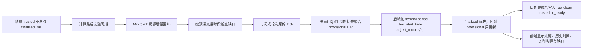
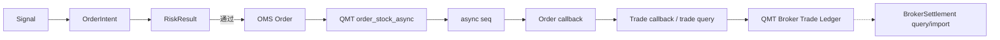

# 行情连续性、交易账本隔离和数值精度专项修复

更新时间：2026-07-13

## 1. 根因与修复结论

本轮确认的根因不是单一前端显示问题：

1. 交易页旧接口未显式传入复权口径，后端默认读取 `front`，随后前端把 Tick 聚合的原始价直接拼入数组。
2. 历史日 Bar 使用日期/零点时间，实时日 Bar 却使用最后一笔 Tick 时间，同一交易日无法命中同一主键。
3. 前端负责 `history + realtime`，缺少口径检查、finalized 优先级和交易时段缺口检查。
4. `trades` 既保存 Paper 成交，也保存 QMT 成交，但旧记录没有明确来源字段；交割接口又直接从该表推导“交割”，导致 Paper 事实可能被误读为券商事实。
5. OMS、账户和持仓持久化使用 `Float`，前端价格散落固定两位或三位格式，交易精度、会计精度和显示精度没有分层。

修复后，行情拼接在后端完成；QMT 成交、Paper 成交和券商交割按来源隔离；资金、订单、成交和持仓会计字段以 `Decimal/NUMERIC` 保存并以字符串进入 API。

## 2. K 线拼接流程



统一主键为：

```text
symbol + period + bar_start_time + adjust_mode
```

规则：

- 时区统一为 `Asia/Shanghai`；对外使用带时区 ISO 8601。
- 日 Bar 的规范起点为交易日 `09:30:00+08:00`。
- 分钟 Bar 沿用 XtData 本地数据的周期标签，并统一去除秒和微秒。
- 午间 `11:30—13:00` 不生成期望 Bar，因此不会被判定为缺口。
- `none` 历史只允许与原始 Tick 聚合 Bar 拼接；`front/back` 与实时原始价同时出现时返回冲突错误。
- 历史 finalized Bar 优先于实时 provisional Bar；当前 Bar 只覆盖同键记录，不追加重复行。
- 启动首次轮询、watchlist 扩展和轮询异常后的恢复轮询都会对
  1m/5m/15m/30m/1h/1d 执行尾部 backfill；K 线查询也可触发所选标的尾部增量回补。
- 官方交易日历、任一标的或任一周期回补失败时保持 `continuity_recovery_required=true`，实时行情
  不会被标记为 fresh；错误按 symbol/period 暴露给 API 和前端。
- 分钟 Bar 使用 miniQMT 周期结束标签；1m 历史序列保留开盘 09:30 集合竞价 Bar，连续竞价实时
  聚合从下一分钟标签开始，午后首根为 13:01。
- 累计量跨日建立新基线；同日计数器回退不降低已观察基线，旧 Tick、未来 Tick 和非官方交易日 Tick
  均拒绝进入 Bar。
- 恢复后的首个在途分钟周期不可持久化；只有之后连续观察的完整周期才能写入 finalized。
  闭市后首次快照也不会覆盖同键的官方历史 finalized Bar。

## 3. 信号、订单、成交和交割状态流



以下事件绝不创建 Broker Trade：`Signal`、`OrderIntent`、风控通过、异步 seq、委托回报、Paper 成交和回测成交。

QMT Broker Trade 的唯一合法来源：`qmt_trade_callback`、`qmt_trade_query`。且必须同时具有 `account_id`、`broker_order_id`、`broker_trade_id`、`broker_reported_at`。数据库唯一约束为 `UNIQUE(account_id, broker_trade_id)`。

### Trade 创建与写入入口审计

| 入口 | 来源 | execution_mode | 可进入 QMT 成交页 | 保护条件 |
|---|---|---:|---:|---|
| `modules/backtest/broker.py` | `backtest_match` | backtest | 否 | 仅自研回测 Broker |
| `modules/paper_trading/service.py` | `paper_match` | paper | 否 | 强制标记模拟来源 |
| `integrations/xtquant_converters.py` | `qmt_trade_callback` | qmt_sim/qmt_live | 是 | 必须来自 XtTrader 成交回调 |
| `integrations/xtquant_converters.py` | `qmt_trade_query` | qmt_sim/qmt_live | 是 | 必须来自 XtTrader 主动成交查询 |
| `modules/execution/service.py` | 持久化入口 | qmt_sim/qmt_live | 是 | 校验来源和四个券商身份字段 |
| `modules/paper_trading/repository.py` | 持久化入口 | paper | 否 | 强制 `paper_match/is_simulated=true` |

`BrokerSettlementRecord` 只有 `broker_settlement_query` 或 `broker_settlement_import` 可以进入交割页。本项目当前 XtTrader 接口没有券商交割单查询适配器，因此该页宁可为空，也不会从成交推导交割。

## 4. 数据库迁移与清理报告

迁移：`20260713_12_market_ledger_precision.py`、`20260713_13_settlement_index.py`、`20260713_14_backtest_accounting_precision.py`。

第三个迁移把回测委托均价、回测成交价格与费用、每日现金/持仓市值/总资产以及组合目标市值从 Float 转为 `NUMERIC(24,8)`；收益率、回撤、净值和权重等无量纲研究指标继续使用 float。

新增表：

- `broker_settlements`：券商交割事实。
- `ledger_quarantine`：来源缺失、身份不完整或跨模式混用记录的保留区。

迁移前在线一致性备份：

```text
data/sqlite/backups/dyadtetrade_consistent_before_market_ledger_precision_20260713_120053.db
PRAGMA integrity_check = ok
```

实际迁移报告：

| 项目 | 数量 |
|---|---:|
| 原始成交记录 | 54 |
| 识别为 Paper 并保留 | 54 |
| 识别为 QMT Broker Trade | 0 |
| 券商交割事实 | 0 |
| 移入 quarantine | 0 |
| 不可逆删除 | 0 |

54 条原记录全部属于 `account_id=paper`，迁移后为 `execution_mode=paper`、`source=paper_match`、`is_simulated=true`。数据库完整性检查为 `ok`。

运行态验收还发现 MiniQMT 午间返回了 23 个标的的当日日线临时值。旧回补逻辑一度把它们写入四层 finalized 数据，共 92 个分层行。修复后已执行：

- 停止行情写入进程；
- 将 23 条 MiniQMT 原始临时行重建到 `data/quarantine/incomplete_finalized_daily_20260713_reconstructed.csv`；
- 从 raw、clean、trusted、bt_ready 中移除 92 个错误 finalized 分层行；
- 复查四层剩余错误 finalized 行为 0；
- 回补入口现在会按“最后完整周期”过滤，15:00 前的当日日线不能进入 finalized 流水线。

## 5. 精度规则

| 数据 | 内部/数据库 | API | 默认显示 |
|---|---|---|---|
| 当前价、委托价、成交价 | Decimal / NUMERIC(24,8) | 字符串 | 按 `price_tick` 推导位数 |
| 持仓均价 | Decimal / NUMERIC(24,8) | 字符串 | `max(price_decimals, 4)` |
| 现金、市值、盈亏 | Decimal / NUMERIC(24,8) | 字符串 | 币种金额 2 位 |
| 佣金、印花税、过户费 | Decimal / NUMERIC(24,8) | 字符串 | 摘要 2 位，明细保留原值 |
| 数量 | Integer，预留 `quantity_decimals` | 数值 | 按证券元数据 |
| 收益率/权重 | 计算可用 float | 数值 | 2—4 位 |

QMT 下单前，Trading Engine 会重新从证券目录读取 `price_tick` 和 `lot_size`，拒绝非 Tick 整数倍价格和非交易单位整数倍数量。

前端统一使用：`formatPrice`、`formatAverageCost`、`formatMoney`、`formatQuantity`、`formatPercent`；业务页面中不再散落 `toFixed`。

## 6. 验证范围与限制

自动测试覆盖：盘中/午间时段、跨交易日、五分钟断线恢复、六周期回补、回补和交易日历失败关闭、
缺口检测、供应商周期标签、累计量回退、旧/非交易日 Tick、复权口径冲突、重复 Tick、当前 Bar 幂等、
信号与订单意图不生成成交、重复成交幂等、Paper/QMT 账本隔离、价格 Tick、部分成交加权成本和
API Decimal 字符串。

最新统一检查结果：226 个 pytest 全部通过，覆盖率 82%；Ruff、Ruff format、strict mypy
（117 个源文件）、5 个前端测试、ESLint、TypeScript/生产构建、Alembic 一致性、后端/API 冒烟和
MiniQMT 只读检查全部通过。

2026-07-13 20:08 闭市后使用 `execution_mode=disabled` 和隔离数据目录对 `510300.SH` 验证六周期
恢复：1m 1446、5m 288、15m 96、30m 48、1h 24、1d 6 行，缺口均为 0。回补后再读取真实闭市
快照，六个 trusted Parquet 文件哈希均未变化，证明首次闭市快照没有覆盖官方 finalized 历史；
`orders_sent=0`。

2026-07-13 午间实机只读验证：

- `600519.SH` 日线：最后历史 finalized Bar 为 `2026-07-10 09:30+08:00`；实时 provisional Bar 为 `2026-07-13 09:30+08:00`，来源 `xtdata_tick_aggregate`，缺口 0。
- `600519.SH` 1 分钟：2026-07-10 至午间共 362 根，最后完整标签 `2026-07-13 11:30+08:00`，午休缺口 0。
- QMT Broker Trade 0、Broker Settlement 0；迁移后的 Paper 运行账本仍只含 `paper_match`（该数量会随正在运行的影子策略增长，2026-07-13 12:45 复核为 58）。
- QMT 账户适配器已消除 C `double` 尾差：现金 `18038.49`、持仓市值 `9005860.81`、总资产 `9023899.30`；`123242.SZ` 均价 `133.69540415`、现价 `130.48900000`、市值 `251843.77`。这些值由后端 Decimal 边界产生，不是前端截断。
- `510300.SH` Paper 持仓手工核算：100 股，均价 4.05000000，成本 405.00000000；现价 4.767，市值 476.700，未实现盈亏 71.70000000；现金 999595.00000000 + 市值 476.700 = 总资产 1000071.70000000。
- 浏览器交易页显示不复权口径、来源、历史/实时边界和连续状态；交割页为空且明确排除 Paper/回测；控制台错误 0。
- 截图：`reports/validation/market-ledger-precision-browser.png`。

当前限制：

1. XtData 分钟标签采用供应商本地标签约定；跨数据源导入前仍需显式映射为该规范。
2. 证券目录个别品种若 MiniQMT 未返回 `PriceTick`，安全回退为 `0.01`，实盘白名单启用前必须人工核对。
3. 当前没有券商交割单查询适配器，交割页只接受未来的券商查询/导入事实，不从普通成交计算。
4. 实时分钟 Bar 由轮询快照的累计量差分得到，适合监控和低频触发，不等同于逐笔全推撮合数据。
5. 本轮继续保持 `qmt_live` 关闭，未发送任何真实资金委托。
