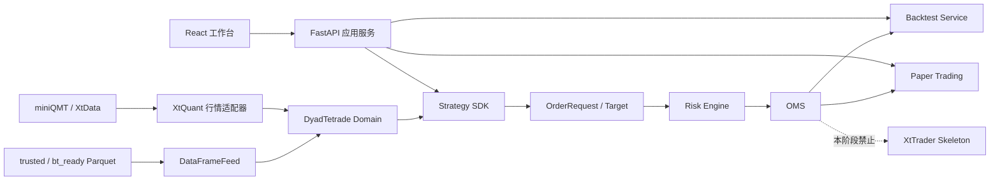
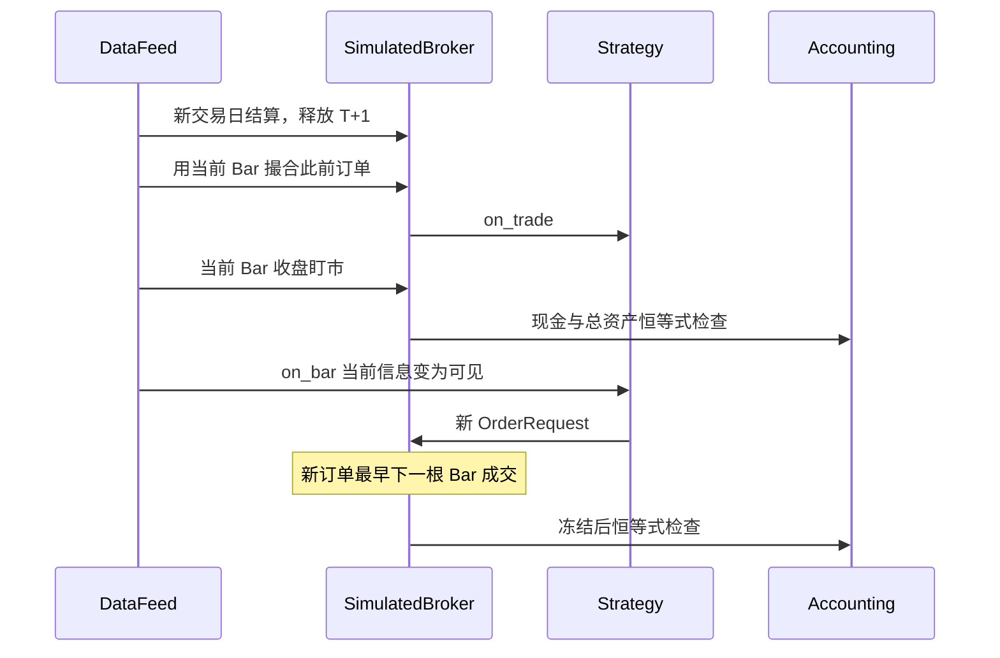
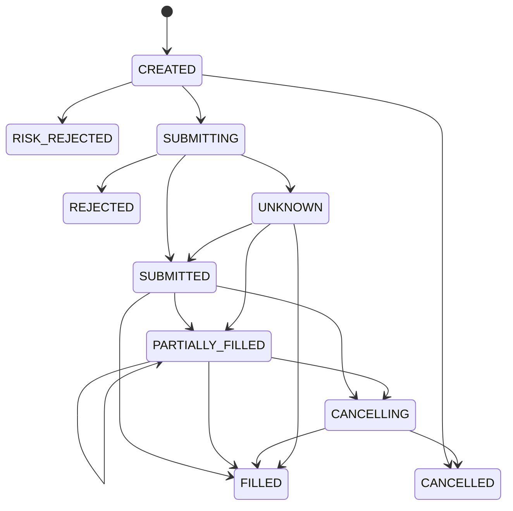

# DyadTetrade 研究、回测、优化与模拟交易工作台

更新时间：2026-07-12

> 已在实盘候选版本收敛前归档，仅作为历史快照。

## 安全边界

本阶段只支持研究、历史回测、组合订单意图和 Paper Trading。`XtTraderGatewaySkeleton`
没有任何券商发送实现，调用 `submit_order()` 必然抛出 `LiveTradingDisabledError`。
所有启动、检查和验收命令均要求：

```text
DYADTETRADE_ENABLE_LIVE_TRADING=false
```

miniQMT 只用于行情、目录和实时快照读取。策略、回测、OMS、风控和前端不接触 XtQuant
原始对象。

## 目录结构

```text
src/dyadtetrade/
  domain/                  厂商无关领域对象、枚举和订单状态机
  events/                  同步/异步/定时/重放事件总线
  modules/
    strategy/              策略基类、上下文、注册发现和示例策略
    research/              因子预处理、IC、分组、衰减和暴露
    backtest/              数据源、撮合、费用、约束、Broker、任务和结果
    performance/           统一绩效指标
    reporting/             JSON/CSV/HTML/PDF/SVG 报告
    optimization/          网格、随机、Optuna、多目标和稳健性检验
    portfolio/             约束配置、再平衡计划与订单意图
    oms/                    幂等订单生命周期和恢复
    risk/                   交易前限制和停止开关
    paper_trading/          实时/模拟 Bar 驱动的 Paper Broker
  integrations/
    xtquant.py              miniQMT/XtData 只读行情边界
    xttrader_gateway.py     厂商无关的只读边界
    qmt_sim_gateway.py      仅限 miniQMT 模拟账户的执行网关
```

## 关键边界



## 回测事件顺序

同一时间戳内使用稳定的证券代码排序，跨时间戳严格递增：



不存在“当日收盘生成信号并按当日收盘成交”的路径。缺失 Bar 不向后填充；停牌、零成交量和
保守一字板不成交。

## 订单状态流



非法迁移立即抛错。终态不能重新激活；成交数量超过剩余数量立即失败。

## A 股会计与成交口径

- 股票和当前 ETF 默认 100 单位整数手；领域 `Instrument.lot_size` 可覆盖。
- 买入数量当日进入 `today_bought`，下一交易日才加入 `available_quantity`。
- 买单冻结估算金额和费用；成交、部分成交或撤单后重算/释放。
- 卖单冻结可卖数量；成交或撤单后减少/释放。
- 佣金、最低佣金、卖出印花税、过户费和滑点分开记录。
- 买入滑点向上、卖出滑点向下。
- 成交量参与率限制支持部分成交。
- 复权价格用于信号连续性；本阶段历史 Bar 没有逐日真实复权因子，报告会保留 `adjust` 和
  数据指纹，不能把复权价格直接作为未来实盘报价。
- 每次冻结、成交、撤单和每日盯市均检查：

```text
cash = available_cash + frozen_cash
total_assets = cash + positions_value + accrued
```

## 策略 SDK

策略只能通过 `StrategyContext` 访问：历史、当前行情、现金、持仓、订单、撤单、调度、记录和
日志。时钟来自运行时，随机种子和状态快照属于任务配置。

内置策略：

- `buy_and_hold`
- `moving_average_cross`
- `equal_weight_rotation`
- `etf_multi_asset_allocation`

自定义策略可放入配置的用户策略目录，并通过 `StrategyRegistry.discover()` 加载；策略文件不得
导入 XtTrader、数据库会话或直接打开数据文件。

## 因子研究

`analyze_factor()` 要求每条记录同时提供 `date` 和 `visible_at`。只要存在
`visible_at > date` 就整体拒绝，避免默默混入未来数据。输出覆盖率、Pearson IC、Rank IC、
ICIR、分组收益、多空收益、衰减、相关矩阵和暴露统计。

股票池和板块成员支持 `as_of` 快照查询。迁移以后的同步会持续记录时点成员；迁移以前只有种子
快照，因此使用当前成分股做更早的长历史回测仍会被文档标记为限制。

## 回测任务和结果

SQLite 保存任务、参数、状态、进度、取消标志、策略版本、数据版本、文件指纹、错误和结果路径。
订单、成交和每日净值使用独立明细表。自动幂等键包含配置和当前 `bt_ready` 文件校验信息；数据
文件更新后不会错误复用旧结果。

报告目录：

```text
reports/backtests/task_<id>/
  <run_id>.json
  <run_id>.html
  <run_id>.pdf
  <run_id>.svg
  <run_id>_equity.csv
  <run_id>_orders.csv
  <run_id>_trades.csv
  <run_id>_positions.csv
  <run_id>_fees.csv
```

## API

| 方法 | 路径 | 用途 |
|---|---|---|
| GET | `/api/v1/strategies` | 策略、版本、参数 Schema 和启用状态 |
| PUT | `/api/v1/strategies/{name}/enabled` | 启用或禁用策略 |
| POST | `/api/v1/backtests?run=true` | 创建并运行幂等回测任务 |
| GET | `/api/v1/backtests` | 分页限制内的回测历史 |
| POST | `/api/v1/backtests/{id}/cancel` | 请求取消 |
| GET | `/api/v1/backtests/results/{id}` | 指标、订单、成交、净值和报告路径 |
| POST | `/api/v1/research/factors/analyze` | 因子 IC、分组和衰减 |
| GET | `/api/v1/research/factors/definitions` | 因子定义和输入 Schema |
| GET/POST | `/api/v1/research/factors/runs` | 因子血缘和持久化运行 |
| POST | `/api/v1/optimizations/run` | 网格/随机/Optuna 小规模搜索 |
| GET/POST | `/api/v1/optimizations/tasks` | 可恢复优化任务 |
| POST | `/api/v1/portfolios/allocate` | 组合权重 |
| POST | `/api/v1/portfolios/order-intents` | 目标权重转订单意图，不发送券商 |
| POST | `/api/v1/portfolios/rebalance-plan` | 带约束再平衡计划 |
| GET | `/api/v1/paper/snapshot` | Paper 资产、持仓、订单、成交和风控 |
| POST | `/api/v1/paper/market/bars` | 推送受控模拟或实时行情 Bar |
| POST | `/api/v1/paper/orders` | Paper 委托 |
| GET/POST | `/api/v1/paper/strategies` | Paper 策略运行和恢复 |
| WS | `/api/v1/ws/monitor` | 任务、连接和 Paper 状态流 |
| GET | `/api/v1/ready` | 数据库、行情、任务和 Paper 对账就绪状态 |
| GET | `/api/v1/metrics` | Prometheus 指标 |

## 数据库迁移

```powershell
alembic upgrade head
alembic current
alembic check
```

迁移 `20260712_01` 至 `20260712_10` 依次创建研究交易表、行业索引、因子血缘、优化任务、
时点股票池、策略运行、基准净值、策略文件生命周期和 QMT 模拟订单映射字段。为保护本地业务和审计数据，自动 downgrade 不删除表；
破坏性降级必须另写带归档步骤的人工审核迁移。

## 运行和验证

```powershell
# 全量检查
.\scripts\check_all.ps1

# 七类真实短区间验收
python scripts\validate_workbench.py

# 启动后端与前端
python -m uvicorn dyadtetrade.api.main:app --reload
cd frontend
npm run dev
```

验收结果保存在 `reports/validation/workbench_validation.json`。本轮实际使用 10 只 A 股、4 只
ETF 的短区间数据；miniQMT 实时快照仅驱动 Paper Broker，没有真实委托。

## 当前限制

- 日线/分钟 Bar 撮合契约已实现；尚未实现逐 Tick 订单簿排队位置。
- 普通、ST、创业板/科创板和北交所涨跌幅策略已实现；仍未接入逐日证券规则历史表，ETF/可转债特殊 T+0 规则也待版本化。
- 公司行动对象已定义，但真实分红、拆股和逐日复权因子尚未进入会计引擎。
- Optuna 支持离散空间、多目标、Pareto 和单进程线程并行；远程 RDB worker 尚未启用。
- Paper 账户、持仓、订单、成交和风控拒绝已接入 SQLite 持久化，并在 API 启动时恢复；多账户隔离、跨进程锁和逐日自动结算仍待完善。
- QmtSimTradingGateway 已完成 XtTrader 启动、模拟账户订阅、只读资产/持仓/委托/成交查询、
  异步委托与撤单接口、回调队列、重连和启动对账；已实际完成模拟账户只读联调。受交易时段和
  首笔委托人工确认约束，本轮没有发送模拟委托，更没有发送真实资金委托。
- ECharts 已独立懒加载；图表分包仍大于 500 kB，后续可继续按图表类型裁剪。
